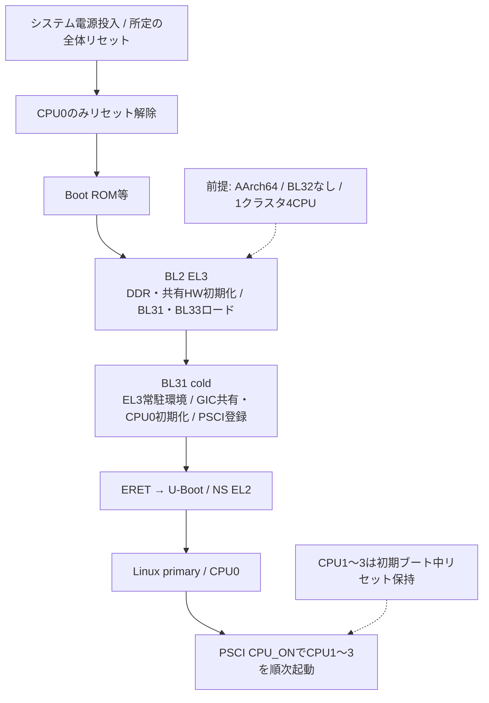
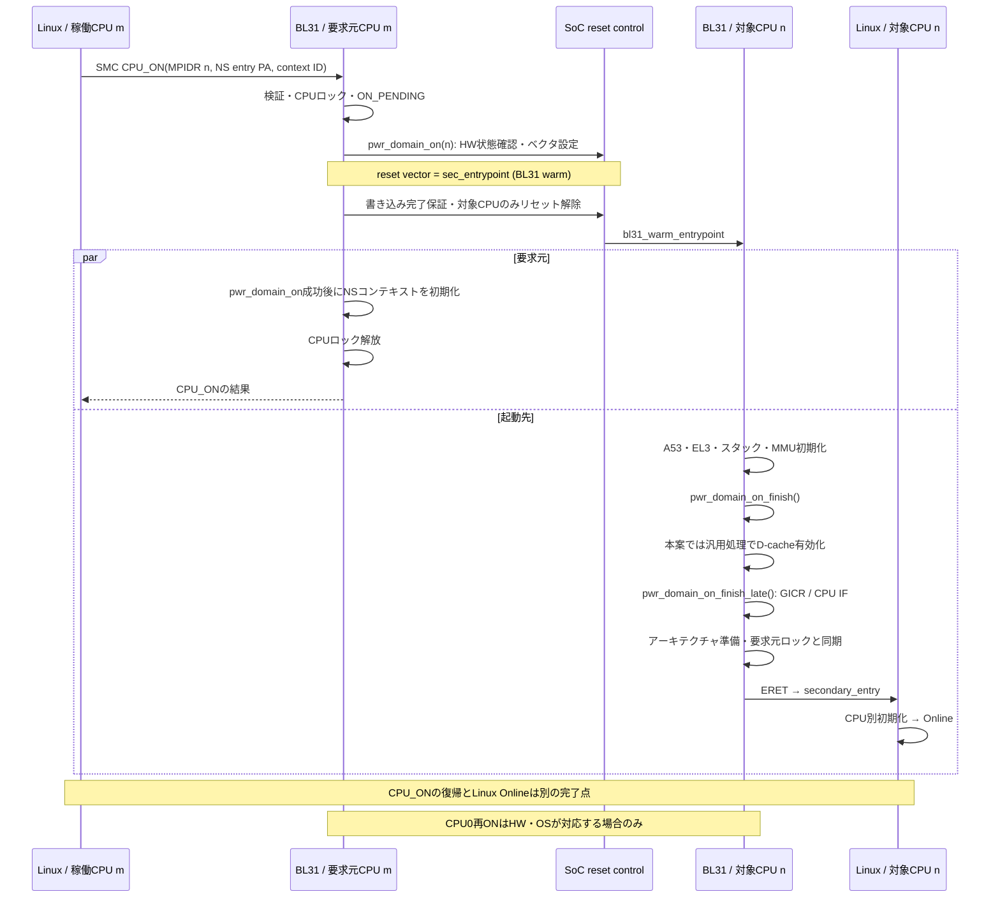
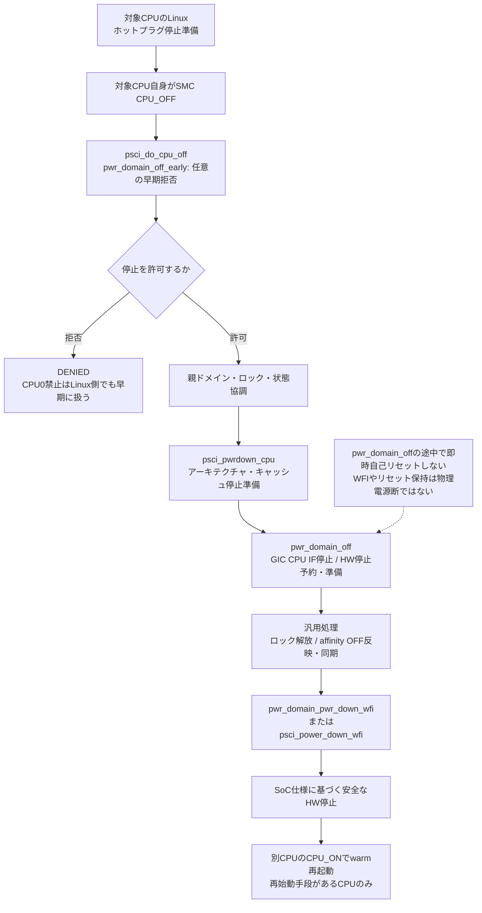
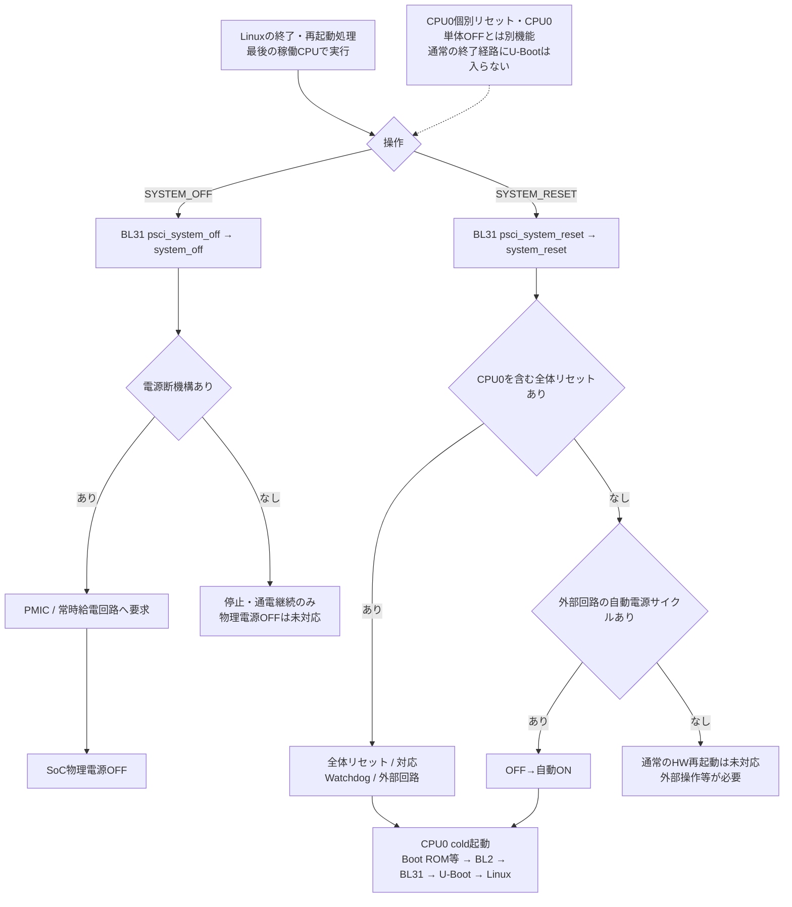
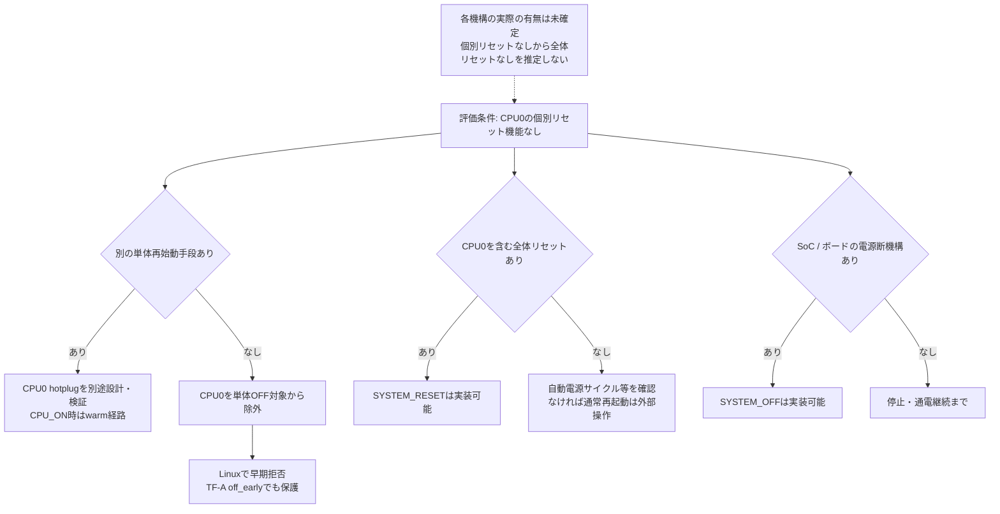
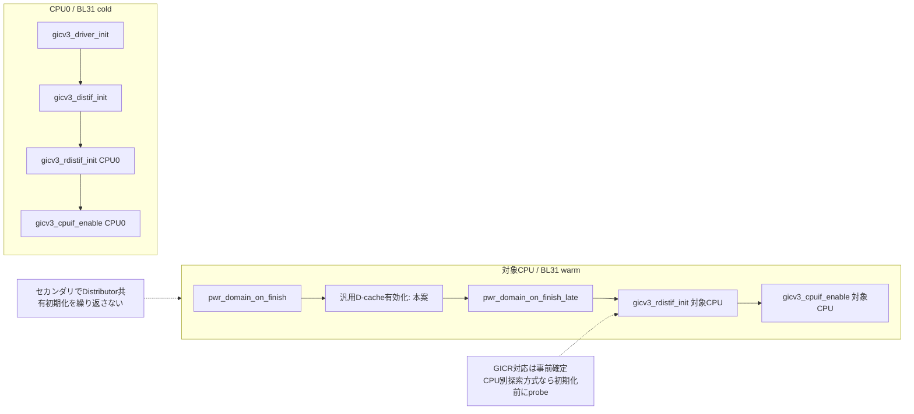

# 図の索引と編集用原稿

## 原PNG

[全体ブロック図](diagrams/original/tf_a_v2_12_boot_power_flow.png)と
[処理順序訂正版](diagrams/original/tfa_v2_12_cpu_power_sequence_corrected.png)を原本のまま保存した。
SHA-256、元ファイル名、画素サイズは[画像台帳](diagrams/image-manifest.json)に記録する。

**読む際の補足：CPU0単体OFF/再ONは再始動手段がある場合のみ。**
CPU0に個別リセットがなく代替経路もない条件では、単体OFF対象をCPU1〜3へ限定する。
SYSTEM_OFF/RESETの物理的な実現手段は未確定で、単体OFFとは独立した設計事項。
元画像内の全体矢印や処理一覧は厳密な関数呼び出し順を保証するものではない。

旧図は[履歴](diagrams/history/README.md)へ分離した。実装時は本ページのテキスト図と
[TF-A実装分担](03-tfa-v2.12-port.md)、[電源設計](04-power-reset.md)を使用する。

## Mermaid原稿

以下は会話内容を保存用に整理した編集可能な原稿。`.mmd`と埋め込みは同一内容。
GitHubで表示するためのソースであり、この作業環境ではMermaidエンジンでの描画検証は未実施。

## CPU0のシステム初期起動

[原稿](diagrams/source/01-cold-boot.mmd)

## PSCI CPU_ON：要求元と起動先

[原稿](diagrams/source/02-cpu-on.mmd)

## PSCI CPU_OFF：停止対象CPU自身の処理

[原稿](diagrams/source/03-cpu-off.mmd)

## システム全体のOFFとRESET

[原稿](diagrams/source/04-system-power.mmd)

## CPU0に個別リセットがない場合の判断

[原稿](diagrams/source/05-cpu0-constraint.mmd)

## GIC-500の共有初期化とCPU別初期化

[原稿](diagrams/source/06-gic-split.mmd)

